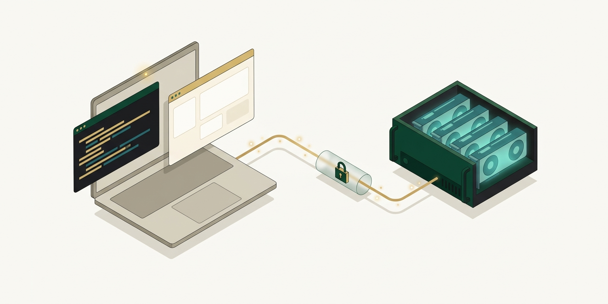
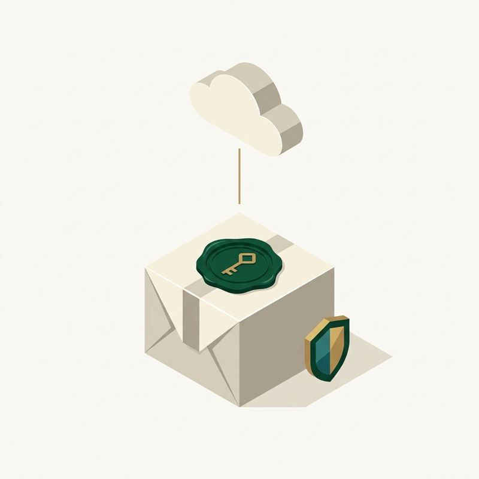
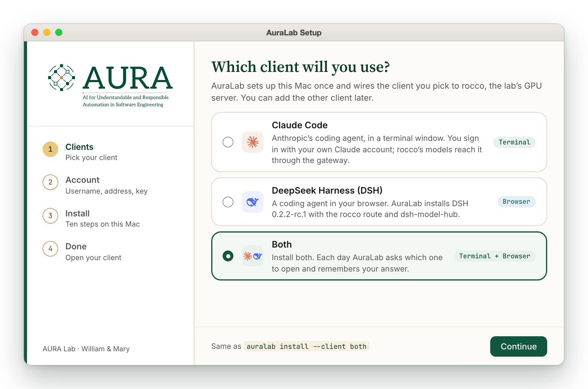
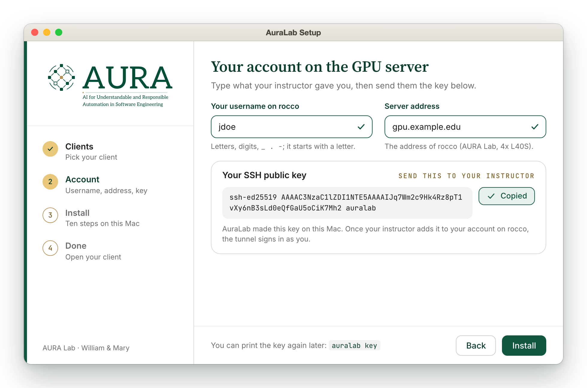
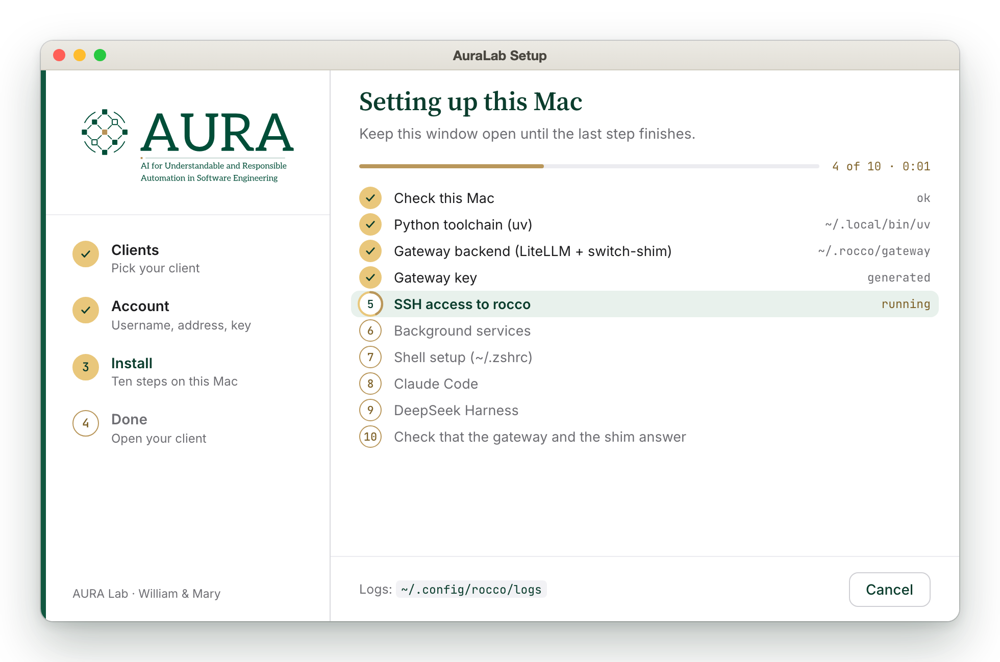
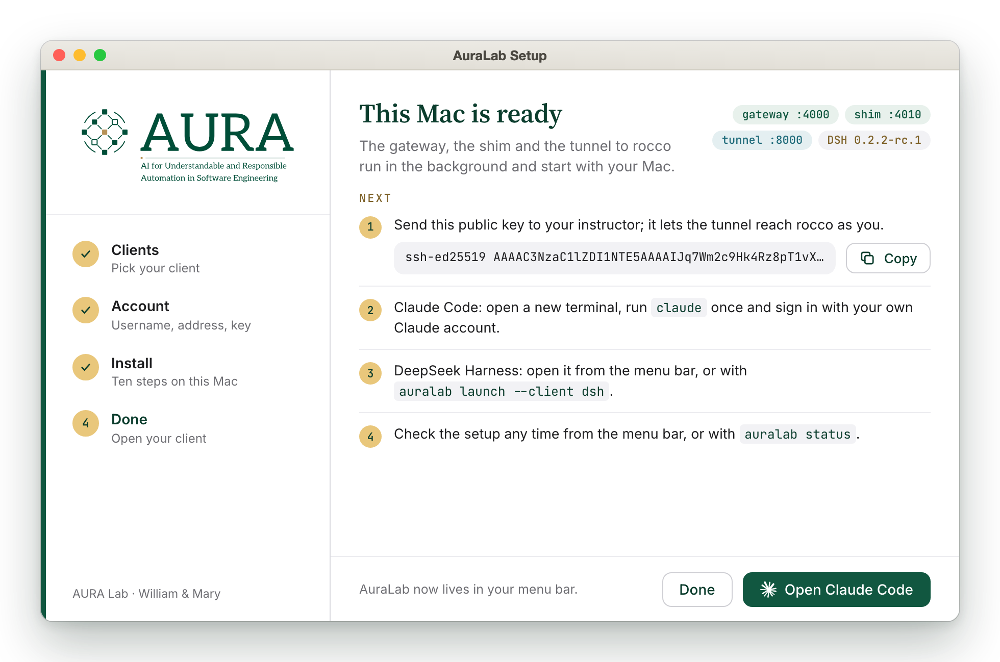
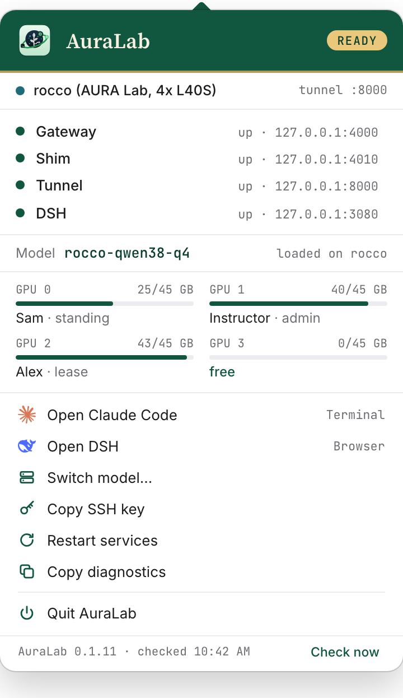
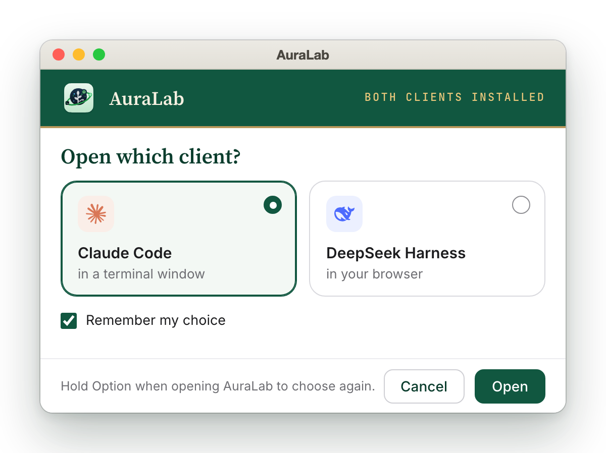
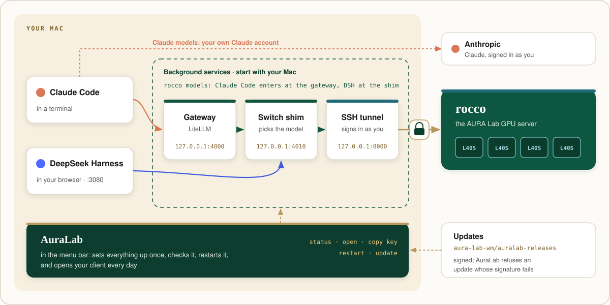

<p align="center">
  
</p>

<h1 align="center">AuraLab</h1>

<p align="center">
  <b>Sets up your Mac for the AURA Lab's AI coding tools once, then opens them for you every day.</b>
</p>

<p align="center">
  <a href="https://github.com/aura-lab-wm/auralab-releases/releases/latest"></a>
  
  
  
</p>

<p align="center">
  <a href="https://github.com/aura-lab-wm/auralab-releases/releases/latest"><b>Download</b></a> ·
  <a href="#install">Install</a> ·
  <a href="#the-setup-page-by-page">The setup</a> ·
  <a href="#every-day">Every day</a> ·
  <a href="#how-it-works">How it works</a> ·
  <a href="#questions">Questions</a>
</p>

AuraLab connects two AI coding clients, **Claude Code** (in a terminal) and **DeepSeek Harness** (in your browser), to
**rocco**, the AURA Lab's GPU server with four NVIDIA L40S cards. It installs what the clients need, keeps it running in
the background, and lives in your menu bar.

This repository holds only the downloads and the update feed. The source code is private.

<table>
  <tr>
    <td width="33%" align="center"></td>
    <td width="33%" align="center"></td>
    <td width="33%" align="center"></td>
  </tr>
  <tr>
    <td valign="top"><b>Set up once.</b> Four pages: pick your client, type what your instructor gave you, wait for ten steps, done.</td>
    <td valign="top"><b>Open it every day.</b> AuraLab sits in the menu bar, shows whether everything is up, and opens your client.</td>
    <td valign="top"><b>Signed updates.</b> New versions arrive from this repository. AuraLab installs only an update whose signature matches.</td>
  </tr>
</table>

## Install

macOS 12 or later, Apple Silicon or Intel.

1. Download the `.dmg` from the [latest release](https://github.com/aura-lab-wm/auralab-releases/releases/latest).
2. Open it and drag **AuraLab v1** to **Applications**.
3. Open **AuraLab v1** from Applications. This build is not notarized by Apple yet, so macOS blocks the first open:
   go to **System Settings → Privacy & Security**, find the line about AuraLab v1 and click **Open Anyway**. You do this once.
4. Follow the four pages of the setup (below). Your instructor gives you your username and the server address.

> [!NOTE]
> Run AuraLab from **Applications**. Started from the disk image or from Downloads, it asks you to move it first: the
> login item and the Dock point to where it lives.

## The setup, page by page

<table>
  <tr>
    <td width="50%"></td>
    <td width="50%"></td>
  </tr>
  <tr>
    <td valign="top"><b>1 · Clients.</b> Pick Claude Code, DeepSeek Harness (DSH), or both. With both, AuraLab asks each day which one to open.</td>
    <td valign="top"><b>2 · Account.</b> Type your username on rocco and the server address. Click <b>Copy</b> next to your SSH public key and send the key to your instructor.</td>
  </tr>
  <tr>
    <td width="50%"></td>
    <td width="50%"></td>
  </tr>
  <tr>
    <td valign="top"><b>3 · Install.</b> Ten steps run in order; the current one is highlighted. Keep the window open until the last one finishes.</td>
    <td valign="top"><b>4 · Done.</b> The next steps, and a button that opens your client. AuraLab now lives in your menu bar.</td>
  </tr>
</table>

Keyboard: **Enter** takes the page's main action (Continue, Install, Retry), **Esc** goes back from the Account page.

## Every day

<table>
  <tr>
    <td width="42%" align="center"></td>
    <td width="58%" valign="top">
      <p>Click the AuraLab icon in the menu bar to see:</p>
      <ul>
        <li>whether the <b>gateway</b>, the <b>shim</b>, the <b>tunnel</b> to rocco and <b>DSH</b> are up;</li>
        <li>the model that last ran on rocco;</li>
        <li><b>Open Claude Code</b>, <b>Open DSH</b>, <b>Copy SSH key</b>, <b>Restart services</b>, and <b>Install update</b> when one is available.</li>
      </ul>
      <p>With both clients installed, AuraLab asks which one to open and remembers your answer:</p>
      
    </td>
  </tr>
</table>

The same from Terminal:

```sh
auralab status                 # what the menu shows
auralab key                    # print your SSH public key again
auralab launch --client dsh    # open DeepSeek Harness
```

## How it works

<p align="center">
  
</p>

Claude Code sends requests for rocco's models to a **gateway** on your Mac (LiteLLM, `127.0.0.1:4000`), which passes
them to the **switch shim** (`127.0.0.1:4010`); DeepSeek Harness talks to the shim directly. The shim sends them through
an **SSH tunnel** to rocco, which signs in with your own key and account. Claude Code's Claude models use your own Claude
account. All three services start with your Mac.

<details>
<summary><b>The ten setup steps</b></summary>

| # | Step | What it sets up |
|---|------|-----------------|
| 1 | Check this Mac | Checks the Mac before anything is changed. |
| 2 | Python toolchain (uv) | `uv` in `~/.local/bin`. |
| 3 | Gateway backend (LiteLLM + switch-shim) | The gateway and the shim, in `~/.rocco/gateway`. |
| 4 | Gateway key | A key for your local gateway. |
| 5 | SSH access to rocco | Your SSH key (`~/.ssh/id_ed25519`) and a `Host` block in `~/.ssh/config`. |
| 6 | Background services | The gateway, the shim and the tunnel, started with your Mac. |
| 7 | Shell setup (`~/.zshrc`) | A marked block: `~/.local/bin` on your `PATH`, the `claude` wrapper that points Claude Code at the gateway, and the variable DSH's rocco route reads. |
| 8 | Claude Code | Installed if you picked it. |
| 9 | DeepSeek Harness | Installed with the rocco route and dsh-model-hub, if you picked it. |
| 10 | Check | Checks that the gateway and the shim answer. |

</details>

## Updates

AuraLab checks this repository's latest release and offers a new version in the menu bar. Every update is signed, and
AuraLab refuses one whose signature does not match.

Click **Install update**. AuraLab restarts and brings its background services (the gateway and the switch shim) up to
the new version on its own, then shows a notification. Your SSH key, your logins and your settings stay as they are. If
that step fails, the menu bar shows **Finish update**: click it to run the step again.

## Questions

<details>
<summary><b>macOS says AuraLab cannot be opened</b></summary>

This build is not notarized yet. Go to **System Settings → Privacy & Security**, find the line about AuraLab v1 and click
**Open Anyway**. You do this once.
</details>

<details>
<summary><b>The setup finished, but the tunnel is not up</b></summary>

The tunnel connects once your instructor has added your SSH key to your account on rocco. Send the key if you have not
(menu bar → **Copy SSH key**, or `auralab key`), then check the menu bar or `auralab status`.
</details>

<details>
<summary><b>The setup stopped at a step</b></summary>

The page names the step and shows the error. Click **Copy details** and send the text to your instructor, or click
**Retry**. The logs are in `~/.config/rocco/logs`. If step 1 stopped, nothing was changed on your Mac.
</details>

<details>
<summary><b>I need my SSH key again</b></summary>

Menu bar → **Copy SSH key**, or run `auralab key`.
</details>

## Uninstall

In Terminal:

```sh
"/Applications/AuraLab v1.app/Contents/MacOS/auralab-app" uninstall
```

then drag AuraLab v1 from Applications to the Trash. The uninstall stops and removes the background services and the
gateway. It leaves your SSH key and the `Host` block in `~/.ssh/config`, Claude Code, DeepSeek Harness and your logins.
Open a new terminal afterwards so the shell forgets the `claude` wrapper.

---

<p align="center">
  <sub><b>AURA Lab</b> · AI for Understandable and Responsible Automation in Software Engineering · William &amp; Mary</sub><br>
  <sub>Illustrations made with Gemini 4 Argon. Screenshots are of the app itself, with example data.</sub>
</p>
